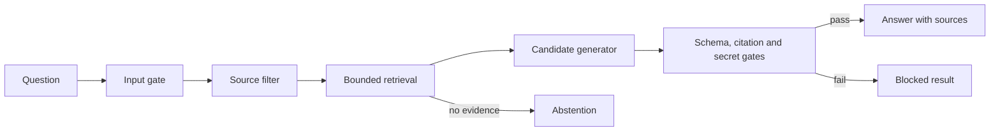

# GroundedGate

**Evidence-grounded answers with visible, deterministic validation gates.**

GroundedGate is a small agent application built around one rule: an answer is released only when its cited quotes match retrieved source passages. It includes a FastAPI service, a Next.js interface, an optional Claude generator, and a credential-free evaluation suite. The bundled documents describe a fictional store so the demo can run without private data.

## What it does

1. Screens the question for credential-like strings.
2. Loads a bounded local Markdown corpus and excludes passages with common instruction-like or credential-like text.
3. Retrieves up to four passages with deterministic BM25 ranking.
4. Drafts claims either with the Anthropic SDK or a clearly labeled offline extractive generator.
5. Checks every claim's source ID and exact quote, then publishes a validation receipt or blocks the draft.



## Run locally

Python 3.11+ and Node.js 22+ are recommended.

```bash
python -m venv .venv
# Activate the virtual environment for your shell, then:
python -m pip install -e ".[dev]"
uvicorn groundedgate.api:app --reload
```

The API runs at `http://localhost:8000`. In another terminal:

```bash
cd web
npm ci
npm run dev
```

Open `http://localhost:3000`. With no credentials configured, the application uses the **offline extractive demo**. To use Claude, set both `ANTHROPIC_API_KEY` and `GROUNDEDGATE_MODEL` in the API process environment. The model identifier is supplied by you; the app does not assume one. `.env.example` lists the settings. Add Markdown files to `data/knowledge/` or point `GROUNDEDGATE_DOCS_DIR` at another local directory, then restart the API.

Example API request:

```bash
curl -X POST http://localhost:8000/ask \
  -H "Content-Type: application/json" \
  -d '{"question":"How long is the return window?"}'
```

## Quality layers

| Layer | Enforced rule |
| --- | --- |
| Input | Reject common API key and private key patterns before a model call. |
| Source | Read only local Markdown files; cap file count, file size, and passage count; skip symlinks. |
| Retrieval | Exclude passages matching common embedded instruction or credential patterns; return at most four positive BM25 matches. |
| Generation | Make at most one model call with a token limit and timeout; never execute retrieved text as instructions. |
| Output | Require a strict claim schema, retrieved source IDs, exact quotes, unique claims, and no credential-like strings. |
| Release | Show the answer only if all output gates pass; otherwise block or abstain with a receipt. |

These checks **do not prove that a claim is semantically entailed by its quote**. They verify structure, provenance, and exact text matching. The source instruction filter is a narrow heuristic, not comprehensive prompt injection protection. The demo has no external write tools or document upload endpoint. See [quality model](docs/QUALITY_MODEL.md) for threat boundaries and next steps.

## Evaluation

```bash
python -m pytest
python -m groundedgate.eval
cd web && npm run build
```

The offline suite uses five fixed questions over the fictional corpus and exits nonzero on regression. The current baseline passes **5/5 cases**. It checks expected answer or abstention status, expected source titles, and deterministic gates. The report is **not** a claim of general answer accuracy. Live model quality, semantic faithfulness, latency, and cost still need a larger labeled dataset before production use.

## Project layout

| Path | Purpose |
| --- | --- |
| `src/groundedgate/` | Retrieval, generation, validation, and API orchestration |
| `web/` | Next.js interface and gate receipt display |
| `data/knowledge/` | Fictional public demo documents |
| `data/evals.json` | Fixed offline regression cases |
| `tests/` | Boundary and API behavior tests |

## License

MIT. See [LICENSE](LICENSE).
